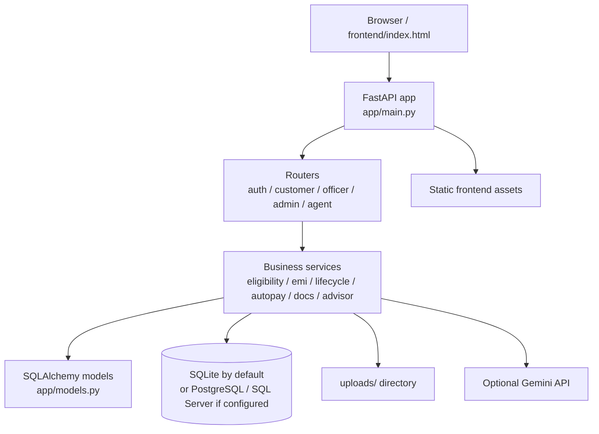

# Loan Lifecycle Guardian — Developer Guide

## 1. Overview

Loan Lifecycle Guardian is a demo banking and lending platform built with FastAPI, SQLAlchemy, and a lightweight browser frontend. The app simulates a modern digital lending workflow across several roles:

- Customers browse products, calculate EMIs, check eligibility, upload documents, apply for loans, track disbursements, and manage repayments.
- Officers review applications, documents, and service requests.
- Administrators manage users, demo workflows, password resets, and collections actions.
- An AI assistant responds with role-aware guidance using the built-in LLM integration when configured.

This repository is intentionally a functional prototype, not a production-grade banking system. The app uses simulated financial logic, demo credentials, and local file storage for uploaded documents.

---

## 2. Goals and scope

The project demonstrates how a lending platform can coordinate:

- customer onboarding and profile management
- product search and loan-fit scoring
- form validation and document verification flows
- officer approval and rejection workflows
- repayment and auto-pay processing
- notifications and service requests
- role-based access control and auditing
- optional AI-powered explanations

The app is designed to be easy to run locally and easy to inspect in a single repository.

---

## 3. High-level architecture



### Main components

- `app/main.py`: app bootstrap, startup hooks, database creation, health endpoint, optional scheduler
- `app/config.py`: environment configuration
- `app/database.py`: DB engine and session factory
- `app/models.py`: domain entities and schema definitions
- `app/schemas.py`: Pydantic request/response schemas
- `app/security.py`: JWT creation, validation, and role enforcement
- `app/routers/`: API route groups by actor
- `app/services/`: business logic and business-role workflows
- `frontend/index.html`: browser UI and API client
- `tests/`: automated behavioral tests

---

## 4. Latest implementation notes

The repository currently includes the strongest value-add for this project: proactive, customer-aware servicing guidance rather than a purely reactive chatbot.

### Proactive customer insights

- `app/services/insights.py` generates customer-specific Guardian alerts based on loan state, installment timing, autopay health, and required customer actions.
- `app/routers/customer.py` exposes the `GET /api/me/insights` endpoint used by the frontend home page.
- `frontend/index.html` renders those alerts and gives the customer action choices consistent with the current demo workflow.

### Agent tool coverage

- `app/services/agent.py` includes `get_my_insights` so the signed-in customer can ask the assistant about the latest proactive alerts.
- The same module includes `simulate_prepayment`, which uses the loan servicing logic to estimate how extra repayment affects the remaining term, interest saved, and monthly burden.
- This tool is intentionally read-only and customer-scoped. It does not mutate the loan state or move any funds.

### Guardrails in place

- The assistant keeps state-changing actions behind a separate confirmation message so the customer must explicitly confirm before the action is executed.
- The offline fallback logic responds to prepayment and “what if I pay extra” style prompts before generic EMI advice, which prevents the assistant from giving a generic answer when the user is clearly asking for a prepayment simulation.
- Tests verify the customer-scoped behavior and the read-only simulation flow through `tests/test_features.py`.

The app remains intentionally demo-oriented: it simulates financial decisions and uses optional LLM behavior when a Gemini key is configured, but it still falls back to structured rules when no model is available.

---

## 5. Project structure

```text
loanlifecycle-guardian/
├── app/
│   ├── __init__.py
│   ├── config.py
│   ├── database.py
│   ├── main.py
│   ├── models.py
│   ├── schemas.py
│   ├── security.py
│   ├── seed.py
│   ├── routers/
│   │   ├── admin.py
│   │   ├── agent.py
│   │   ├── auth.py
│   │   ├── customer.py
│   │   ├── officer.py
│   │   └── __init__.py
│   └── services/
│       ├── advisor.py
│       ├── agent.py
│       ├── autopay.py
│       ├── documents.py
│       ├── eligibility.py
│       ├── emi.py
│       ├── errors.py
│       ├── insights.py
│       ├── lifecycle.py
│       ├── llm.py
│       ├── notify.py
│       ├── portfolio.py
│       ├── servicing.py
│       └── views.py
├── db/
│   └── migration_add_service_requests.sql
├── docs/
│   └── DEVELOPER_GUIDE.md
├── frontend/
│   └── index.html
├── tests/
│   ├── __init__.py
│   ├── conftest.py
│   ├── test_core.py
│   └── test_features.py
├── .env.example
├── README.md
├── requirements.txt
├── requirements-extra.txt
├── requirements-dev.txt
├── run.py
├── uploads/
├── test_uploads/
└── loan_guardian.db
```

---

## 6. Core domain model

The application centers around customer, loan, and servicing entities.

### User and role model

The `User` model supports three roles:

- `CUSTOMER`
- `OFFICER`
- `ADMIN`

Role checks are enforced by the JWT and by route-level dependencies in `app/security.py`.

### Customer profile and account model

- `CustomerProfile` contains KYC data such as DOB, PAN, monthly income, credit score, employment type, and address.
- `BankAccount` stores simulated account balance and net-banking behavior.
- These are linked to the user and drive eligibility and repayment logic.

### Loan lifecycle model

- `LoanProduct` defines approved loan categories and constraints.
- `LoanApplication` tracks a proposed application before official approval.
- `Loan` represents an actual issued loan with status, schedule, and account linkage.
- `Installment` tracks each scheduled EMI and its payment state.
- `Payment` stores payment events and failure codes.

### Supporting entities

- `Document` stores upload metadata, document status, and review information.
- `Notification` powers proactive alerts and inbox messages.
- `ServiceRequest` supports customer support requests.
- `AuditLog` records actions and state changes.
- `PasswordResetRequest` tracks administrative review of password-reset challenges.

---

## 7. Authentication and security model

Authentication is token-based and implemented in `app/security.py`.

### JWT flow

- The app creates a JWT on login or registration.
- The token contains the user id, role, and expiration.
- A bearer token is required for protected endpoints.
- `get_current_user()` validates the token and loads the current user.
- `require_roles(...)` restricts access to specific user types.

### Password handling

Passwords are not stored in plain text. The code uses PBKDF2 with a random per-user salt and secure comparison.

### Authorization rules

- Customers can view and manage only their own profile, loans, documents, and applications.
- Officers can act on application queues, document reviews, and support requests.
- Administrators can access user-management and demo operational actions.

---

## 8. Request flow by user journey

### A. Customer registration and login

1. A user posts to `/api/auth/register`.
2. The app creates a `User` with role `CUSTOMER`.
3. It also creates a `CustomerProfile` and a default `BankAccount`.
4. A JWT is returned and used for authenticated access.
5. `/api/auth/login` validates credentials and returns the token.

### B. Product browsing and eligibility checks

Customer-facing endpoints let users:

- view active loan products at `/api/products`
- calculate EMI with `/api/emi/calc`
- run a pre-check with `/api/me/applications/precheck`
- view recommendations and insights

### C. Application creation

When a customer submits an application:

- the request data is validated by Pydantic schemas
- eligibility checks are run
- the application is inserted with a status such as `SUBMITTED`
- document requirements are tracked and the app may route to officer review

### D. Document handling

The application supports upload and validation for identity, income, or property documents.

Document validation includes:

- MIME/content-type checks
- size limits
- duplicate detection by hash
- reviewer state transitions (`UPLOADED`, `VERIFIED`, `REJECTED`)
- officer review for cases that need manual confirmation

### E. Officer review and decisioning

The officer workflow includes:

- viewing the application queue
- reviewing customer documents
- checking eligibility and risk summary
- requesting more information
- approving or rejecting a loan application

### F. Loan servicing and repayment

Once a loan is approved and disbursed:

- the system creates installments
- the customer can enable or disable auto-pay
- manual payments can be applied
- overdue and failed payments are tracked
- notifications are raised for customer alerts

### G. Agent assistance

The `/api/agent/chat` endpoint connects a signed-in user to the optional LLM assistant. The assistant can explain:

- loan status and next steps
- alert explanations
- auto-pay issues
- prepayment simulations
- actionable guidance within the demo rules

The AI layer is intentionally bounded: it can explain and recommend, but it does not approve loans or move money.

---

## 9. Configuration and environment

The application reads settings from environment variables and, if present, `.env`.

### Default configuration

From `app/config.py`:

| Variable | Default | Description |
|---|---|---|
| `DATABASE_URL` | `sqlite:///./loan_guardian.db` | Database connection string |
| `JWT_SECRET` | dev-only fallback secret | Must be changed in real use |
| `JWT_EXPIRE_MIN` | `120` | JWT lifetime |
| `GEMINI_API_KEY` / `GOOGLE_API_KEY` | unset | Optional LLM provider key |
| `GEMINI_MODEL` | `gemini-3.8-flash` | LLM model name |
| `DEMO_MODE` | `1` | Enables demo features |
| `SEED_DEMO` | `1` | Creates initial sample data |
| `AUTOPAY_SCHEDULER_SECONDS` | `0` | Enables background auto-pay scheduling |
| `MAX_AUTOPAY_ATTEMPTS` | `5` | Simulated autopay attempts |
| `UPLOAD_DIR` | `./uploads` | Document storage path |
| `MAX_UPLOAD_MB` | `5` | Max upload size in MB |

### Example PowerShell setup

```powershell
$env:JWT_SECRET = "use-a-unique-long-random-value-here"
$env:DEMO_MODE = "0"
$env:SEED_DEMO = "0"
$env:DATABASE_URL = "sqlite:///./loan_guardian.db"
```

---

## 9. Database and persistence

### Default database

The app uses SQLite by default, which is convenient for local demos and automated tests.

### Schema creation behavior

At startup, the app runs `Base.metadata.create_all(engine)`. This creates tables if missing but does not perform full schema migration for existing databases.

### Generated data and demo hygiene

The local database and upload directories are intentionally excluded from Git because they may contain sensitive or generated data.

---

## 10. Demo data and seeded accounts

When `SEED_DEMO=1`, the app creates a small demo environment with fixed test accounts.

| Role | Username | Password |
|---|---|---|
| Administrator | `admin` | `Admin@123` |
| Officer | `officer1` | `Officer@123` |
| Customer | `rahul`, `priya`, `suresh`, `anita`, `vikram` | `Cust@1234` |

These are intended for local demos only.

---

## 11. API surface

The application exposes the API under `/api`. Protected endpoints use JWT bearer auth.

### Authentication endpoints

- `POST /api/auth/register`
- `POST /api/auth/login`
- `GET /api/auth/me`

### Customer endpoints

- `GET /api/products`
- `POST /api/emi/calc`
- `GET /api/me/accounts`
- `GET /api/me/loans`
- `POST /api/me/applications/precheck`
- `POST /api/me/applications`
- `GET /api/me/applications`
- `GET /api/me/profile`
- `PUT /api/me/profile`
- `POST /api/me/password`
- `GET /api/me/insights`

### Officer/admin endpoints

- `GET /api/officer/applications`
- `GET /api/officer/dashboard`
- `POST /api/officer/documents/{id}/review`
- `GET /api/admin/users`
- `POST /api/admin/run-autopay`
- `GET /api/admin/audit`

### Agent endpoint

- `POST /api/agent/chat`

### Health endpoint

- `GET /api/health`

The full OpenAPI schema is visible at `/docs` when the app is running.

---

## 12. Business services and responsibilities

Major service modules include:

### `services/eligibility.py`
Responsible for checking whether a customer is suitable for a given loan product and deriving risk signals.

### `services/emi.py`
Contains EMI computations and payment math.

### `services/lifecycle.py`
Coordinates application creation, resubmission, and state transitions.

### `services/autopay.py`
Simulates auto-debit processing, account checks, failure codes, and retry logic.

### `services/documents.py`
Handles document validation and file metadata flows.

### `services/notify.py`
Generates notifications and audit records for user actions and system events.

### `services/insights.py`
Builds proactive customer guidance based on loan and payment status.

### `services/agent.py` and `services/llm.py`
Provide the assistant logic and the optional LLM integration layer.

---

## 13. Testing strategy

The repository includes a focused test suite under `tests/`.

### Coverage areas

- EMI calculations
- authorization and role checks
- validation and acceptance rules
- loan decision rules
- document review and auto-pay outcomes
- customer isolation checks
- service requests and customer support flows
- confirmation-gated agent actions

Run the suite with:

```powershell
python -m pytest -q
```

The project uses a separate SQLite test database and a dedicated upload directory to keep test data isolated from local demo data.

---

## 14. Local development workflow

### Create the environment

```powershell
py -3.10 -m venv .venv
.\.venv\Scripts\Activate.ps1
python -m pip install --upgrade pip
python -m pip install -r requirements-dev.txt
```

### Run the app

```powershell
python run.py
```

Then open:

- `http://127.0.0.1:8000`
- `http://127.0.0.1:8000/docs`
- `http://127.0.0.1:8000/api/health`

---

## 15. Security and operational considerations

This app is designed for demos and local experimentation, but there are still important guardrails:

- use a unique and strong `JWT_SECRET` outside demo use
- keep `.env` values private and never commit credentials
- do not expose demo accounts to real customers
- treat document uploads as sensitive data
- keep local DB and upload directories out of Git

---

## 16. Extension points

The codebase is structured to be extended in natural ways:

- add new loan products via `LoanProduct` seed data
- expand notifications in `services/notify.py`
- add more document-check rules in `services/documents.py`
- add queue management and reporting in officer logic
- swap the demo LLM for a more controlled enterprise assistant

---

## 17. Summary

Loan Lifecycle Guardian is a compact but complete demo of a digital lending application: registration, eligibility, application review, document checks, loan servicing, repayments, notifications, and admin oversight. It is especially useful as a learning and prototyping project for FastAPI + SQLAlchemy + role-based API design.
